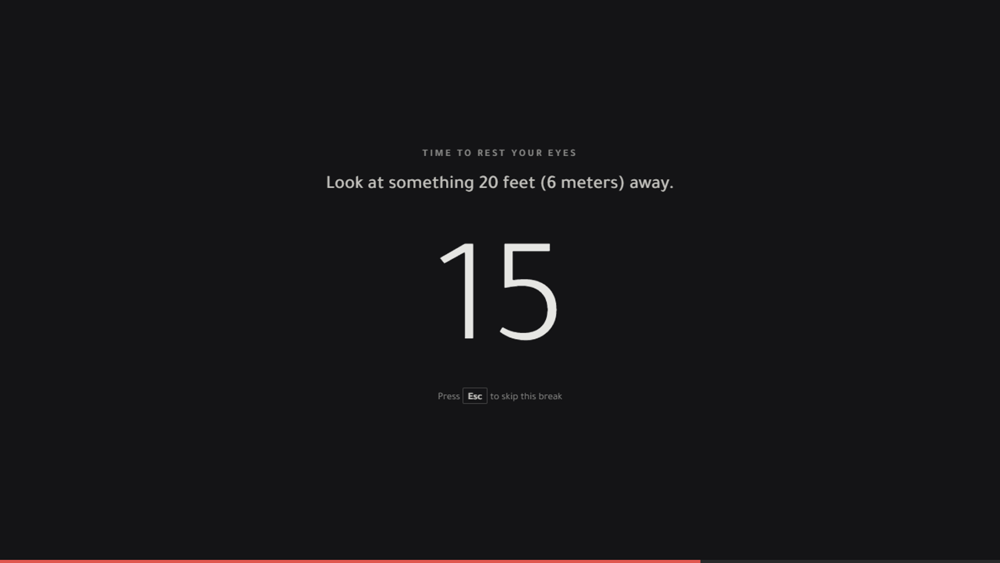
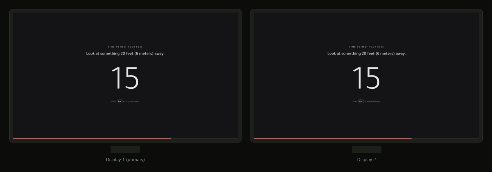
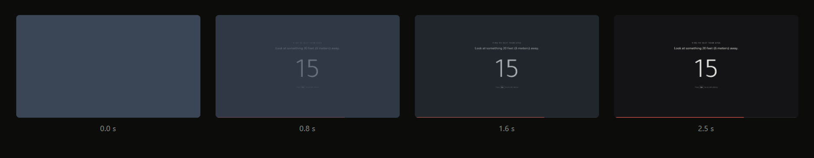
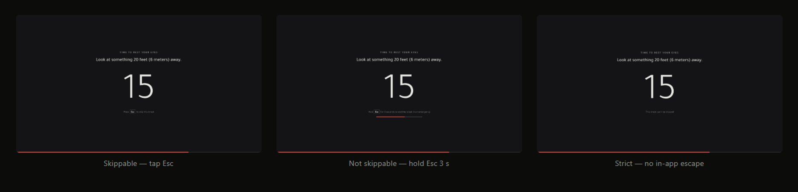
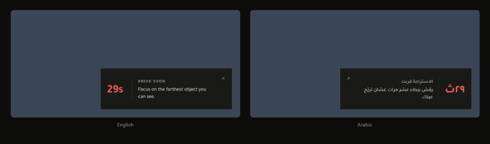
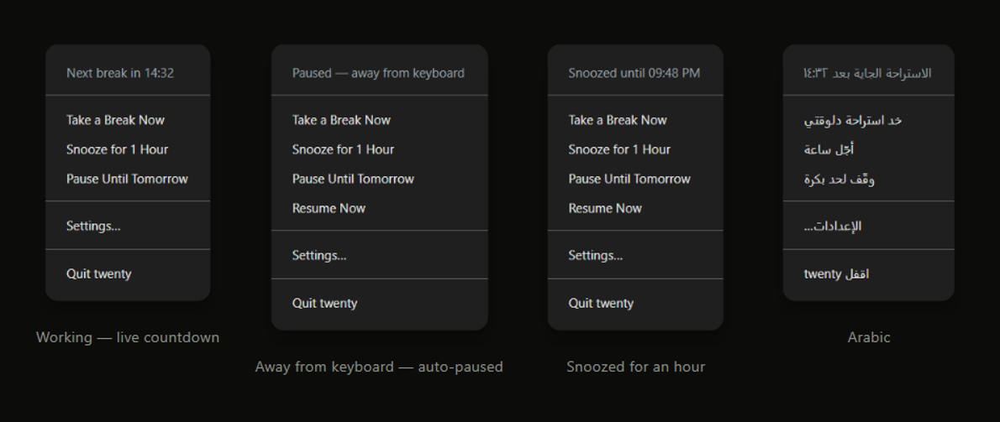
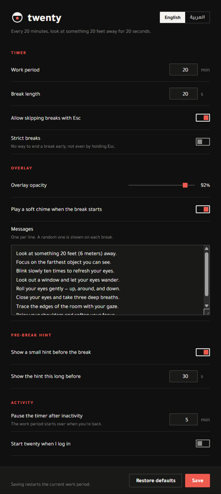
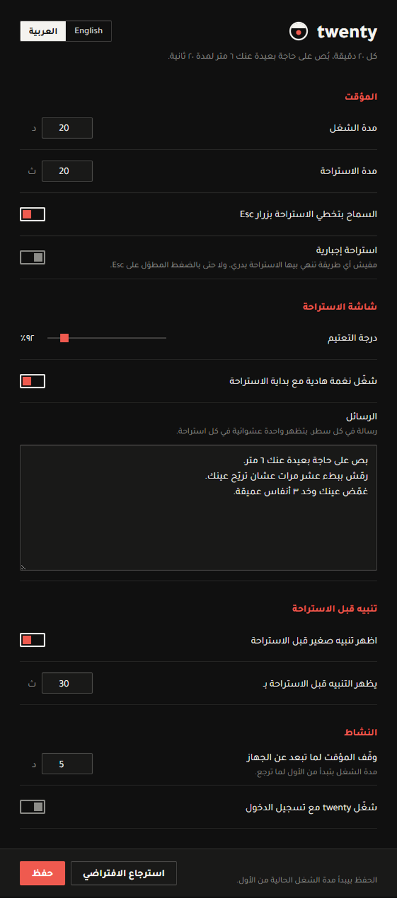
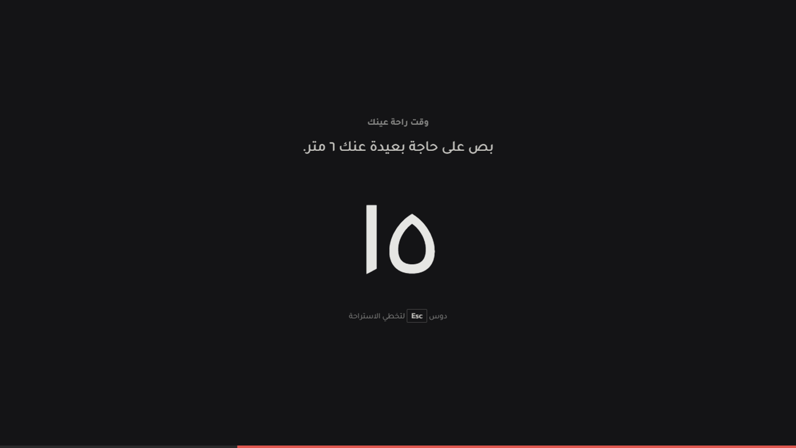

# twenty

A cross-platform desktop application designed to help users prevent eye strain by enforcing the **20-20-20 rule**: every **20 minutes**, look at something **20 feet away** for at least **20 seconds**.

The application runs in the background and controls screen activity to ensure the user takes regular breaks to rest their eyes.

Built with **Electron + TypeScript**. All eleven features below are implemented.



## Screenshots

### Break overlay — on every display

Covers every connected screen at once, so there is no "other monitor" to keep
working on. A random message from your list sits above the countdown, and a thin
bar along the bottom edge drains as the break runs.



### Graceful fade-in

No abrupt lock: the veil eases in over 2.5 seconds with a soft chime.



### Skippable, hold-to-escape, or strict

Tap Esc to skip, hold Esc for 3 seconds when skipping is off (the emergency
hatch, with its progress bar), or opt into strict breaks with no in-app way out.



### Pre-break hint

A small toast in the corner shortly before the break, with its own countdown and
a message. It never takes focus or restricts the mouse.



### Tray menu

Live countdown to the next break, plus Take a Break Now, Snooze for 1 Hour and
Pause Until Tomorrow. After 5 minutes without keyboard or mouse input the timer
pauses itself, and the work period starts over when you return.



### Settings — English and Arabic

Work period, break length, skipping and strict breaks, overlay opacity, chime,
your own messages, the hint and its lead time, the idle threshold, and start at
login. Arabic switches every window to right-to-left with Arabic-Indic digits.

| English                                                      | العربية                                                        |
| ------------------------------------------------------------ | -------------------------------------------------------------- |
|  |  |



Mouse confinement can't be shown in a still image: during a break the pointer is
pinned to the centre of the primary display until the break ends. Regenerate
these images with `npm run screenshots`.

## Getting Started

```bash
npm install
npm run dev          # run in development (tray-only app — look for the eye icon)
npm run dev:fast     # development with seconds-scale timers (a break every ~15 s)
npm test             # unit tests (timer engine, settings, messages)
npm run smoke        # end-to-end check: launches the app, asserts a full break cycle
npm run dist         # build the installer for your OS into release/
npm run screenshots  # regenerate the README images in docs/screenshots/
```

> **Note:** if you launch from an IDE-integrated terminal, unset
> `ELECTRON_RUN_AS_NODE` first (VS Code extension hosts export it, which breaks
> Electron apps). PowerShell: `Remove-Item env:ELECTRON_RUN_AS_NODE`.

During a break, tap **Esc** to skip (when skipping is enabled) — or **hold Esc
for 3 seconds** to force-end a break in an emergency, even when skipping is
disabled. With **Strict breaks** enabled in Settings, neither works: the break
always runs its full length, and the only way out is ending the process (e.g.
Task Manager via Ctrl+Alt+Del), which releases the mouse. Settings, snooze ("Snooze for 1 Hour") and "Pause Until Tomorrow"
live in the tray menu.

The UI is available in **English** and **Arabic** (switch at the top of
Settings). Both languages use the Tajawal font; Arabic gets a right-to-left layout and Arabic-Indic
digits across Settings, the break overlay, the hint toast and the tray menu.
Break messages are yours to edit in either language.

### Platform notes

|                 | Overlays | Mouse confinement                                   | Idle detection  |
| --------------- | -------- | --------------------------------------------------- | --------------- |
| Windows         | ✅       | ✅ `ClipCursor`                                     | ✅              |
| macOS           | ✅       | ✅ CoreGraphics cursor dissociation                 | ✅              |
| Linux (X11)     | ✅       | ✅ `XGrabPointer`                                   | ✅              |
| Linux (Wayland) | ✅       | ⚠️ not possible by design (no global pointer grabs) | ✅ on GNOME/KDE |

Linux tray requires StatusNotifier/appindicator support. Developer
documentation lives in [CLAUDE.md](CLAUDE.md) and [.agents/AGENTS.md](.agents/AGENTS.md).

---

## Needed Features

The application must implement the following features:

### 1. Repeating Dark Overlay

- Automatically covers screens with a dark background overlay after a user-defined work period has elapsed.
- The timer repeats continuously (i.e., a new work period starts after each break ends).

### 2. Multi-Monitor Support

- The dark background overlay must be displayed on all connected screens simultaneously, ensuring that the user cannot continue working by looking at another screen.

### 3. Display Messages

- The dark background overlay must display a message chosen from a configured set of eye-care or relaxation messages.

### 4. Customization Settings

- Users must be able to control:
  - The work period duration (timer interval).
  - The opacity level of the dark overlay background.
  - The group/list of messages to display.

### 5. Skippable Breaks

- Users must be able to configure whether the dark background overlay can be skipped or not.
- Optional **strict breaks**: the break cannot be ended early from the overlay at all (no Esc tap, no Esc hold).

### 6. Pre-Break Hint Notification

- The option to show a small message hint shortly before the dark overlay is displayed.
- Ability to configure the time interval before the break when this hint is shown.
- The hint notification must display a message selected from the set of eye-care messages.

### 7. Input Restriction (Mouse Confinement)

- The dark background overlay must prevent the mouse from moving to enforce the eye break.
- The pre-break hint notification must allow normal mouse movement.

### 8. Cross-Platform Desktop Support

- The desktop application must be cross-platform, running on Windows, macOS, and Linux.

### 9. Smart Activity & Idle Detection

- Automatically pauses the work timer when no user input (keyboard or mouse) is detected for more than 5 minutes.
- This prevents triggering a break immediately after the user returns from an away-from-desk break or lunch.

### 10. Graceful Transitions

- Avoids abruptly locking the screen. The overlay should implement a smooth 2–3 second fade-in transition, accompanied by a soft, gentle audio chime to notify the user.

### 11. System Tray Integration

- The application runs in the background with a system tray/menu bar icon: an eye whose lid lowers as the next break gets closer and closes during the break.
- The tray menu shows the remaining time until the next break.
- Provides quick actions to "Snooze for 1 Hour" or "Pause until Tomorrow".
